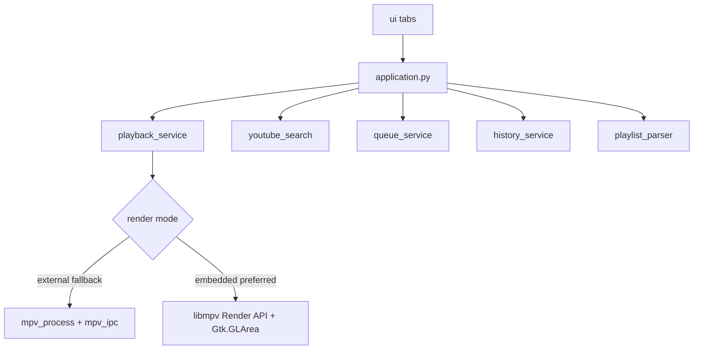

# Architecture

## Overview

## Modules

| Area | Responsibility |
|---|---|
| `application.py` | Gtk.Application lifecycle |
| `config.py` | App ID, mpv profiles |
| `paths.py` | Data/config/cache/runtime locations |
| `dependencies.py` | `mpv` / `yt-dlp` discovery |
| `player/` | Process ownership, IPC, playback API |
| `services/` | Search, queue, history, playlist, title cache |
| `ui/` | Five GTK tabs |
| `platform/` | Linux / macOS adapters |

## Playback modes

- **Embedded (preferred when available):** in-process libmpv via `python-mpv`, frames drawn with the **Render API** into `Gtk.GLArea` (`ui/video_area.py`). Not window-handle (`wid`) embedding.
- **External (fallback / baseline):** spawn mpv with `--input-ipc-server` and control via JSON IPC

Selection: `player/render_selection.py` (`KHAD_RENDER_MODE=auto|embedded|external`).

UI code must call `PlaybackService`, not construct mpv CLI arguments. Queue/play logic is shared across modes.

## Legacy baseline

`legacy/app.py` is the behavioural source of truth for the refactor (SHA-256 recorded in `legacy/BASELINE.md`).
